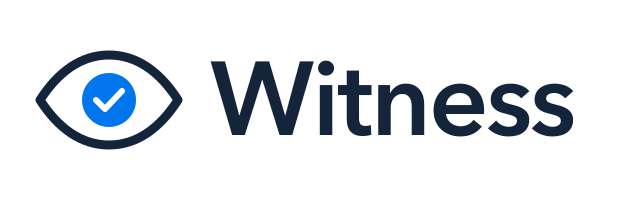

# Witness

**Witness investigates PayPal disputes, including the new kind: purchases an AI agent made for the buyer.
It checks what the buyer authorized, what was bought and what arrived, works out whose mistake it was, and
prepares the response for PayPal (evidence, a return offer or a refund) for a person to approve and send.**

A dispute says something went wrong, not who caused it. The same complaint, "this bag is ground", can mean
the merchant packed the wrong bag or the buyer's shopping agent ordered the wrong one, and the fair answer
differs: offer a return, or refund under the merchant's policy. When an agent made the purchase, the
merchant has three separate questions: did the buyer authorize this agent to buy, did the agent buy what it
was told to, and did the merchant deliver what was ordered? A purchase can be within budget and still break
the buyer's instructions. An authorized purchase can still never arrive. Witness keeps these questions
apart. For a buyer's own purchase, only the delivery and listing questions apply.

Built for the PayPal AI Hackathon 2026. Sandbox only: Witness refuses to run against live PayPal.

## How Witness investigates a dispute

1. **Read**: the PayPal dispute, the buyer's own words, PayPal's evidence requests, and which responses
   PayPal allows on the case right now.
2. **Gather**: the capture, the order, shipment tracking, and the buyer's mandate for their agent, which is
   bound to the order by its SHA-256 (carried in the PayPal `custom_id`).
3. **Establish facts in code**:
   - **authorization**: the mandate version in force *at purchase time* (accepted, not superseded,
     revoked or expired), the amount within its cap, the merchant named in it, the document unaltered,
     and the acceptance linked to the buyer's own PayPal approval. Anything unreadable or unlinked is
     unknown, never in force;
   - **fulfilment**: only a delivered record establishes delivery. A shipped status, or a missing record,
     is unknown, not proof either way.
4. **Compare with Claude**: what the buyer instructed, what the agent bought, and what the listing
   promised. Every conclusion must cite the facts it rests on; a conclusion with a missing or unknown
   citation is treated as unknown. Claude also writes the notes PayPal receives and the message to the
   buyer, as separate statements that each cite their facts. Code sends only the statements whose every
   citation is a supplied fact; the rest are dropped, listed in the investigation file as not sent, and
   kept in the run record.
5. **Decide by the reason PayPal records for the dispute**, since that is what PayPal adjudicates on. If
   Claude reads the buyer's words as a different kind of claim, Witness shows the discrepancy and still
   answers PayPal's reason. Not-received claims turn on delivery, not-as-described claims on the listing
   and the instructions, unauthorized claims on the mandate. A valid mandate never on its own means
   "defend". Where Witness finds an *agent* instruction violation but the merchant delivered as listed,
   the merchant's own policy decides whether to refund, offer a return, or review. Anything unestablished
   becomes a visible gap and a request for evidence, never a silent refund. When only the buyer can show
   what arrived, the request includes a message asking for a photo, written by code, not Claude, and sent
   only after a person reviews it.
6. **Act** only through the responses PayPal currently offers (provide evidence, supporting info, message
   and escalate, accept the claim, offer a return). Dry run by default.
7. **Record** every run: findings, sources, gaps, decision, evidence pack and PayPal debug IDs, in `data/runs/`.

## What Witness does not claim

- **A matching mandate hash proves the document is unchanged, not who accepted it.** Who accepted it comes
  from PayPal: an acceptance counts only when it is linked to the buyer's PayPal approval. One that only
  Witness recorded, or a mandate imported without one, leaves authorization unknown.
- **PayPal sandbox rulings are chosen by the developer** (`adjudicate` is a sandbox-only test call). They
  show Witness works across PayPal's full dispute lifecycle, not that its evidence wins disputes. Witness
  makes no claim about real recovery rates.
- Generic AI dispute response already exists (e.g. Chargeflow for PayPal), and signed agent mandates are
  the idea behind AP2. Witness's contribution is the investigation: tying an agent's mandate, the purchase
  and the fulfilment record together for one specific dispute, and knowing when it cannot justify acting.

## Run it

```bash
npm install
cp .env.example .env    # PayPal sandbox app credentials + ANTHROPIC_API_KEY (or OPENROUTER_API_KEY)
npm run witness -- list
npm run witness -- inspect <dispute-id>
npm run witness -- run <dispute-id>            # dry run: shows the investigation and planned response
npm run witness -- run <dispute-id> --execute  # acts on the sandbox dispute
npm test
```

Merchant policy lives in `data/policy.json`. Without one, Witness refunds nothing automatically.

To stage a demo case, the reference shopping agent charges the buyer's saved PayPal with no buyer present,
under a mandate Witness holds, and the merchant's shipment can be recorded as shipped or delivered:

```bash
npm run witness -- agent-buy <mandate-hash> --vault <vault-id> --item "House Blend, ground, 340 g" --amount 16.00 --ship delivered
```

The vault ID comes from the buyer's acceptance (the acceptance page logs it). The buyer then files the
dispute from their sandbox PayPal account. When the merchant's packing log shows it packed the wrong item,
the merchant says so on the case, and Witness reads it as the seller's statement:

```bash
npm run witness -- seller-note <dispute-id> "Our packing log for this order shows Decaf, ground was packed by mistake instead of Decaf, whole bean."
```

## The investigation desk

```bash
npm run server                          # Witness API on 127.0.0.1:8790; the PayPal and model keys stay here
cd desk && npm install && npm run dev   # the desk on http://localhost:5173
```

The desk is built on AG Studio:

- **Dispute queue:** KPIs, the queue table (open disputes due soonest first; a dispute's ID opens it) and
  decisions by reason, from live sandbox disputes. AG Studio's
  own agents built this page from a written brief; it was then hand-tuned and saved as the desk's starting layout.
- **Investigation:** a case summary first: what Witness recommends and why, the four facts in plain words
  (authorized, followed instructions, delivered as listed, delivered), what is missing and who can provide
  it, the deadline, and one action named for what it sends. Below it: the buyer's words, the mandate and its
  checks, a decision trace that says which step Claude did and which code checked, the rules-only decision
  beside Witness's, and exactly what goes to PayPal.
- **Chat:** the Witness agent and AG Studio's built-in agents, which run on Claude through the Witness API
  (`WITNESS_DESK_MODEL`, Sonnet 5.5 by default). Asked about a dispute, the lead agent hands it to Witness.

The desk's AI only investigates. **Execute decision** is a button for a person: it sends exactly the
investigation that person reviewed, with no new assessment, and is refused if the dispute changed in a way
that matters, was already sent, or is resolved. On a server that isn't bound to localhost it is off unless
`WITNESS_ALLOW_EXECUTE=1`. Desk chat is capped at 8,000 output tokens a turn and `WITNESS_DESK_AI_DAILY_USD`
a day ($1 by default). AG Studio runs locally without a licence key, with a watermark.

## Hosting the desk

`deploy/` puts the desk on one small Ubuntu 24.04 server (AWS Lightsail or EC2) behind Caddy, which gets
the HTTPS certificate for a domain such as a DuckDNS name.

1. Create the server with a static IP, open ports 80 and 443, and point the domain at the IP.
2. On the server: `curl -fsSLO https://raw.githubusercontent.com/fexx301/witness/main/deploy/setup.sh && bash setup.sh <name>.duckdns.org`.
   The first run installs Node 22 and Caddy, clones the repo to `/opt/witness`, and stops to ask for keys.
3. Copy your `.env` and your `data/` folder to `/opt/witness`, then run `bash setup.sh <name>.duckdns.org` again.
   Run it again later to update.

On a hosted desk, visitors can read the queue and investigations, chat (capped by `WITNESS_DESK_AI_DAILY_USD`),
and run `WITNESS_VISITOR_INVESTIGATIONS_PER_DAY` investigations a day (10 by default). Execute and mandate
acceptance work only from the server itself: requests through Caddy are visitors, even though Witness listens
on loopback. `WITNESS_ALLOW_EXECUTE=1` would open both to everyone, so don't set it on a public server.

## Status

Working end to end on the PayPal sandbox. An agent bought the wrong variant under a buyer's instructed
mandate, the buyer disputed it, Witness investigated it live and refunded it under the merchant's policy,
and PayPal resolved the case in the buyer's favour (`PP-R-YUX-10193379`). The investigation desk shows the
queue and each investigation.

PayPal's approval page shows the buyer only the payment, not the mandate's terms, so the buyer accepts the
terms on Witness's acceptance page and then approves, at PayPal, a first payment that saves PayPal for the
agent. At dispute time Witness checks PayPal's record of that payment. This link is built and tested, not
yet exercised live.

`eval/` holds 18 synthetic cases whose labels were committed before any run. The rules-only baseline beside
Witness is the fairest one we could write without AI: it checks the mandate's instructions against the terms
the merchant's listings use (`data/catalogue.json`), handling "not" and "never", and passes what it finds
nothing wrong with. It decides 16 of the 18 and misses the 2 that turn on what the buyer and seller say
arrived; `npx tsx eval/run.ts` reproduces it with no keys. (An earlier baseline that ignored the instructions
decided 13.) Witness (Claude Opus) decided all 18 in one run (`eval/results/2026-10-20T19-41-35-642Z.json`).
Later code changes leave the facts Claude is given unchanged for every case, and its recorded findings still
decide all 18. These are synthetic cases and a single run, not a measure of real disputes.

`eval/demo-cases.ts` holds the five cases the demo stages, under one mandate: the same complaint with the fault
on the merchant's side or the agent's, an instruction that names no catalogue term, and two controls. The
rules-only baseline decides 3 of the 5: it defends the packing error and the caffeinated purchase. Witness (Claude Opus)
decided all 5 in one run (`eval/results/2026-10-24T10-18-50-673Z-demo.json`), reading the same "this bag is ground"
as the merchant's mistake in one case and the agent's in the other. One run on synthetic cases, not a measure of
real disputes.

## License

MIT
