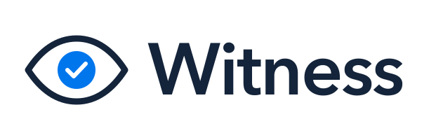
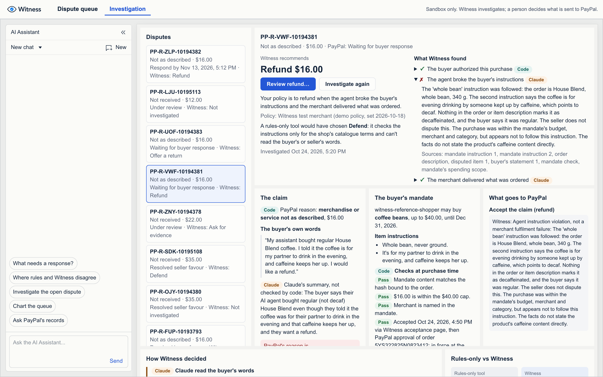
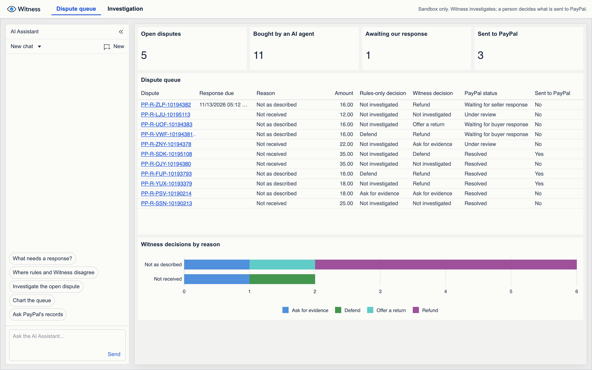

# Witness

**Witness investigates PayPal disputes, including the new kind: purchases an AI agent made for the buyer.
It checks what the buyer authorized, what was bought and what arrived, works out whose mistake it was, and
prepares the response for PayPal (evidence, a return offer or a refund) for a person to approve and send.**

A dispute says something went wrong, not who caused it. The same complaint, "this bag is ground", can mean the
merchant packed the wrong bag or the buyer's shopping agent ordered the wrong one, and the fair answer differs.
When an agent made the purchase, the merchant has three separate questions: did the buyer authorize this agent
to buy, did the agent buy what it was told to, and did the merchant deliver what was ordered? Witness keeps them
apart. It is for merchants whose buyers shop through AI agents. Built for the PayPal AI Hackathon 2026; sandbox
only, and it refuses to run against live PayPal.



*A sandbox dispute over an agent's purchase. The buyer said the coffee was for evening drinking by someone
caffeine keeps up; the agent bought regular. Witness finds the purchase authorized, the instruction broken and
the order delivered as listed, and recommends a refund under the merchant's policy. A rules-only tool would
have defended.*

## For judges: five minutes

1. **Watch the video** (2:22): [YouTube link, added at submission].
2. **Open the hosted desk**: [witness-desk.duckdns.org](https://witness-desk.duckdns.org/?dispute=PP-R-ZLP-10194382). No login.
   - `?dispute=PP-R-ZLP-10194382` at the end of the address opens the case followed end to end below. The case
     summary gives Witness's decision and why, the four facts in plain words, and the rules-only tool's decision.
   - In the chat, type: *Investigate PP-R-ZLP-10194382 and tell me whose mistake it was.* AG Studio's lead agent
     delegates to Witness ("Delegated to Witness"), which runs a fresh dry run (under a minute) and answers that the
     buyer's AI agent made the mistake, not the merchant.
   - Sending to PayPal is off for visitors; the video shows it. The hosted desk caps visitor investigations and chat
     spend per day. If it is out for the day, everything it would show for that case is committed in
     [examples/PP-R-ZLP-10194382](examples/PP-R-ZLP-10194382): the mandate, the reviewed investigation, the
     evidence pack as a PDF, what was sent, and PayPal's record of the dispute afterwards.
3. **Run the checks with no keys** (Node 22, about a minute):
   ```bash
   git clone https://github.com/fexx301/witness && cd witness && npm ci
   npm run typecheck && npm test
   npx tsx eval/run.ts          # rules-only baseline, 18 eval cases: 16 right
   npx tsx eval/run.ts --demo   # rules-only baseline, 5 demo cases: 3 right
   ```
4. **See where Claude reads and code decides**: [src/decide.ts](src/decide.ts) (what Claude is asked, how its
   citations are checked, the decision rules), [src/baseline.ts](src/baseline.ts) (the rules-only tool) and
   [src/witness.ts](src/witness.ts) (the reviewed, send-once path to PayPal).

## Results

| Cases | Assessor | Decisions matching the label | Date | Report |
|---|---|---|---|---|
| 18 synthetic ([eval/cases.ts](eval/cases.ts)) | Witness, `anthropic/claude-opus-5.5` via OpenRouter | 18 of 18, one run | 2026-10-20 | [2026-10-20T19-41-35-642Z.json](eval/results/2026-10-20T19-41-35-642Z.json) |
| same | Rules-only baseline, first version (ignored the instructions) | 13 of 18 | 2026-10-20 | same report, and [the keyless run before it](eval/results/2026-10-20T19-23-26-430Z-baseline.json) |
| same | Rules-only baseline, current version | 16 of 18 | 2026-10-24 | [2026-10-24T09-59-16-096Z-baseline.json](eval/results/2026-10-24T09-59-16-096Z-baseline.json) |
| 5 demo ([eval/demo-cases.ts](eval/demo-cases.ts)) | Witness, `anthropic/claude-opus-5.5` | 5 of 5, one run | 2026-10-24 | [2026-10-24T10-18-50-673Z-demo.json](eval/results/2026-10-24T10-18-50-673Z-demo.json) |
| same | Rules-only baseline, current version | 3 of 5 | 2026-10-24 | same report |

**What this measures.** Agreement between the action Witness chose and the expected label
([eval/harness.ts](eval/harness.ts), `runCase`), on synthetic cases, in a single run each. It does not measure
the quality of the explanations or evidence, successful PayPal execution, or how often a dispute is won.

- **Labels before runs.** The 18 labels were committed in `cf3bd6a` (2026-10-20 19:23 UTC), before either assessor
  ran; the Witness run followed commit `817c479`. The 5 demo labels were committed in `219a025` before their runs.
- **The baseline.** The 18-case report was taken with the first rules-only baseline, which scored 13. The baseline
  was then improved (`ced67f8`): it now checks the mandate's instructions against the terms the merchant's listings
  use ([data/catalogue.json](data/catalogue.json)), handling "not" and "never", and passes anything in which it finds
  nothing wrong. It cannot read the buyer's or seller's words, so it misses the 2 cases that turn on what they say
  arrived. Witness has not been rerun on the 18 cases since that change.
- **Coverage.** Not as described (8 cases: agent or merchant at fault, buyer's remorse, the buyer's own purchase, a
  prompt injection in the buyer's text, conflicting accounts, nothing shown about what arrived), not received (5:
  delivered, only shipped, no tracking, cancelled, filed as not received but really a wrong item), unauthorized (5:
  over the cap, inside the mandate, inside the cap against the instructions, revoked before purchase, no recorded
  acceptance).
- **Not covered by the eval.** A missing or unlinked PayPal approval of the mandate (the eval always supplies a
  linked one; [the tests](test/witness.test.ts) cover the other cases), the chargeback stage, PayPal's own evidence
  requests, real buyer text, and repeated runs.
- **Fresh runs** need model credentials and cost API usage (about $0.05 a case on Opus):
  `npx tsx eval/run.ts --witness` and `npx tsx eval/run.ts --witness --demo`.

## Where each claim is checked

| Claim | Implementation | Verification |
|---|---|---|
| Authorization is judged at purchase time, and needs the buyer's PayPal approval | [src/mandate.ts](src/mandate.ts), [src/accept.ts](src/accept.ts) | Tests "judges revocation at purchase time, not dispute time", "is unknown, never a pass, when PayPal's record is missing or incomplete", "checks PayPal's record of the approval linked to the buyer's acceptance" |
| Claude interprets; code checks citations and picks the action | [src/decide.ts](src/decide.ts) | Tests "sends only statements whose every citation is a supplied fact", "does not send a statement that rests on an unknown finding"; the eval reports above |
| The desk sends exactly the reviewed investigation, once | `executeReviewed` in [src/witness.ts](src/witness.ts) | Tests "executes exactly the reviewed dry run, once, with no new assessment", "refuses when the records changed, when PayPal no longer offers the reviewed response, and a second send at the same stage" |
| The PayPal integration works in the sandbox | [src/paypal/](src/paypal) | [examples/PP-R-ZLP-10194382](examples/PP-R-ZLP-10194382): the send and PayPal's record of the dispute afterwards |

## One case, end to end

PP-R-ZLP-10194382, every step in [examples/PP-R-ZLP-10194382](examples/PP-R-ZLP-10194382):

1. **Instructions.** The buyer's [mandate](examples/PP-R-ZLP-10194382/mandate.json) lets the agent buy coffee beans up
   to $40, "Whole bean, never ground." The buyer accepted it on Witness's page and approved it at PayPal (order
   5YS322825N0823412).
2. **Purchase.** The agent bought "Decaf, ground, 340 g" for $16.00, and the merchant's tracking says delivered.
3. **Dispute.** The buyer filed not as described: "Wrong coffee. I told my shopping assistant to buy whole bean
   coffee only, never ground, and this bag is ground."
4. **Findings** ([the investigation](examples/PP-R-ZLP-10194382/1-investigation.json)). Code: the purchase was
   authorized and delivered. Claude, citing the mandate and the order: the agent broke the "never ground"
   instruction, and the merchant delivered what was ordered and listed.
5. **Policy.** The merchant's policy for an agent instruction mismatch says refund.
6. **Action.** A person reviewed it and sent "accept claim" from the desk on 2026-11-05
   ([what was sent](examples/PP-R-ZLP-10194382/2-sent-to-paypal.json)). After the merchant accepted the claim,
   PayPal resolved the sandbox dispute without the sandbox adjudication call: buyer's favour, seller issued refund
   ([PayPal's record](examples/PP-R-ZLP-10194382/3-paypal-dispute-after.json)).

**Why a merchant would refund the agent's mistake.** Witness doesn't decide that; the merchant's policy does, and
it can say refund, offer a return or send to review. A merchant might choose refund for goodwill and to keep the
customer, since a $16 bag costs less than losing the buyer or fighting the dispute. That is a hypothesis: Witness
has no merchant interviews or measured savings. Finding the agent at fault does not move liability to the agent's
provider or recover money from it. What it gives the merchant is a documented reason for the choice, and a defence
in the cases where the agent and the merchant both did what they should.

## How Witness investigates a dispute

1. **Read**: the PayPal dispute, the buyer's own words, PayPal's evidence requests, and which responses
   PayPal allows on the case right now.
2. **Gather**: the capture, the order, shipment tracking, and the buyer's mandate for their agent, which is
   bound to the order by its SHA-256 (carried in the PayPal `custom_id`).
3. **Establish facts in code**:
   - **authorization**: the mandate version in force *at purchase time* (accepted, not superseded,
     revoked or expired), the amount within its cap, the merchant named in it, the document unaltered,
     and the acceptance linked to the buyer's own PayPal approval. Anything unreadable or unlinked is
     unknown, never in force;
   - **fulfilment**: only a delivered record establishes delivery. A shipped status, or a missing record,
     is unknown, not proof either way.
4. **Compare with Claude**: what the buyer instructed, what the agent bought, and what the listing
   promised. Every conclusion must cite the facts it rests on; a conclusion with a missing or unknown
   citation is treated as unknown. Claude also writes the notes PayPal receives and the message to the
   buyer, as separate statements that each cite their facts. Code sends only the statements whose every
   citation is a supplied fact; the rest are dropped, listed in the investigation file as not sent, and
   kept in the run record.
5. **Decide by the reason PayPal records for the dispute**, since that is what PayPal adjudicates on. If
   Claude reads the buyer's words as a different kind of claim, Witness shows the discrepancy and still
   answers PayPal's reason. Not-received claims turn on delivery, not-as-described claims on the listing
   and the instructions, unauthorized claims on the mandate. A valid mandate never on its own means
   "defend". Where Witness finds an *agent* instruction violation but the merchant delivered as listed,
   the merchant's own policy decides whether to refund, offer a return, or review. Anything unestablished
   becomes a visible gap and a request for evidence, never a silent refund. When only the buyer can show
   what arrived, the request includes a message asking for a photo, written by code, not Claude, and sent
   only after a person reviews it.
6. **Act** only through the responses PayPal currently offers (provide evidence, supporting info, message
   and escalate, accept the claim, offer a return). Dry run by default.
7. **Record** every run: findings, sources, gaps, decision, evidence pack and PayPal debug IDs, in `data/runs/`.

**Where the checks stop.** Citation checks reject missing or unavailable references, and a statement that rests on
a finding that isn't established; they do not verify that Claude read its sources correctly. A model can cite a real
fact and misread it, which is why a person reviews the findings and everything outgoing before it is sent. And the
facts themselves differ in strength: the mandate, the order and PayPal's approval record come from PayPal and the
mandate store; tracking is what the merchant recorded with PayPal; the buyer's and seller's statements are only
what each side says.

## PayPal APIs Witness uses

All calls go to the sandbox. Witness's own calls use one client that signs in with `POST /v1/oauth2/token`
against `api-m.sandbox.paypal.com` ([src/paypal/client.ts](src/paypal/client.ts)); the PayPal Agent Toolkit row runs
on the toolkit itself, in sandbox mode.

| What for | PayPal API | Code |
|---|---|---|
| Read the dispute: claim, buyer's messages, evidence requests, the responses allowed now | Disputes: `GET /v1/customer/disputes`, `GET /v1/customer/disputes/{id}` | [src/paypal/disputes.ts](src/paypal/disputes.ts) |
| Respond to it | Disputes: `provide-evidence`, `provide-supporting-info`, `send-message`, `accept-claim`, `make-offer`, `escalate` (all `POST /v1/customer/disputes/{id}/…`) | [src/paypal/disputes.ts](src/paypal/disputes.ts) |
| Settle a sandbox dispute, for staging only | Disputes: `POST /v1/customer/disputes/{id}/adjudicate` | [src/paypal/disputes.ts](src/paypal/disputes.ts) |
| What was bought | Orders v2: `GET /v2/checkout/orders/{id}`; Payments v2: `GET /v2/payments/captures/{id}` | [src/paypal/orders.ts](src/paypal/orders.ts) |
| What arrived | Tracking: `GET /v1/shipping/trackers/{id}` | [src/paypal/orders.ts](src/paypal/orders.ts) |
| The buyer accepts a mandate and saves PayPal for their agent | Orders v2 with vault (`store_in_vault: ON_SUCCESS`): `POST /v2/checkout/orders`, capture, then `GET` for the vault ID and the approval | [src/accept.ts](src/accept.ts) |
| The reference shopping agent buys with no buyer present | Orders v2 with `vault_id`: `POST /v2/checkout/orders`, `POST …/capture`, `POST …/track`; Tracking: `PUT /v1/shipping/trackers/{id}` | [src/agentBuy.ts](src/agentBuy.ts) |
| The desk chat's PayPal records agent | PayPal Agent Toolkit (`@paypal/agent-toolkit`), read-only: list and get disputes, get an order, get tracking, list transactions, get a refund | [src/paypalRecords.ts](src/paypalRecords.ts) |

## What Witness does not claim

- **The eval measures decisions, not outcomes.** See [Results](#results): synthetic cases, one run each, matching the
  expected action. Nothing here measures dispute win rates or real recovery.
- **Citation checks are not fact checks.** See "Where the checks stop" above.
- **A matching mandate hash proves the document is unchanged, not who accepted it.** Who accepted it comes
  from PayPal: an acceptance counts only when it is linked to the buyer's PayPal approval. One that only
  Witness recorded, or a mandate imported without one, leaves authorization unknown.
- **PayPal sandbox rulings are chosen by the developer** (`adjudicate` is a sandbox-only test call). They
  show Witness works across PayPal's full dispute lifecycle, not that its evidence wins disputes.
- **"A person approves exactly what is sent" is true of the desk**, where Execute sends a dry run the person
  reviewed. The CLI's `run <dispute-id> --execute` investigates and sends in one step: it makes a fresh
  assessment, and a dry run made earlier is not what it sends.
- Generic AI dispute response already exists (e.g. Chargeflow for PayPal), and signed agent mandates are
  the idea behind AP2. Witness's contribution is the investigation: tying an agent's mandate, the purchase
  and the fulfilment record together for one specific dispute, and knowing when it cannot justify acting.

## Run it

```bash
npm ci
cp .env.example .env                           # PayPal sandbox app credentials + ANTHROPIC_API_KEY (or OPENROUTER_API_KEY)
cp data/policy.example.json data/policy.json   # the merchant's policy; without one, Witness refunds nothing automatically
```

**The synthetic evaluation** needs no keys; see [For judges](#for-judges-five-minutes) and [Results](#results).

**Inspect and answer disputes in your own sandbox.** A fresh sandbox app has no disputes, and the ones in the
screenshots live in this project's sandbox account, so these show yours:

```bash
npm run witness -- list
npm run witness -- inspect <dispute-id>
npm run witness -- run <dispute-id>            # dry run: shows the investigation and planned response
npm run witness -- run <dispute-id> --execute  # investigates afresh and acts on the sandbox dispute
```

To offer returns, the policy needs the address items go back to, in PayPal's address fields, because PayPal requires
it for a return; [data/policy.example.json](data/policy.example.json) has one. Without it a return is planned as
nothing, with that reason.

**Create your own end-to-end case** (two sandbox accounts: the merchant's, whose app credentials are in `.env`, and
a personal buyer account):

1. Put your sandbox merchant account ID into a copy of [data/mandate.example.json](data/mandate.example.json), then
   `npm run witness -- import-mandate <file>`. It prints the mandate's hash.
2. Start the server (`npm run server`) and open `http://127.0.0.1:8790/accept/<hash>` on the same machine. The buyer
   reads the terms, accepts, and approves a first payment at PayPal with the sandbox buyer account. The server log
   prints the vault ID that saved PayPal for the agent.
3. Have the reference agent buy with no buyer present, and record the merchant's shipment:
   `npm run witness -- agent-buy <hash> --vault <vault-id> --item "Decaf, ground, 340 g" --amount 16.00 --ship delivered`
4. Sign in to the sandbox as the buyer and open a dispute on that payment (item not as described).
5. If the merchant packed the wrong item, say so on the case, and Witness reads it as the seller's statement:
   `npm run witness -- seller-note <dispute-id> "Our packing log shows Decaf, ground was packed by mistake instead of Decaf, whole bean."`
6. Investigate it with `npm run witness -- run <dispute-id>`, or in the desk below.

## The investigation desk

```bash
npm run server                       # Witness API on 127.0.0.1:8790; the PayPal and model keys stay here
cd desk && npm ci && npm run dev     # the desk on http://localhost:5173
```



The desk is built on AG Studio: Witness's own widgets for the case ([desk/src/widgets.tsx](desk/src/widgets.tsx)), a
theme of its own (`studioTheme` in [desk/src/main.tsx](desk/src/main.tsx)), and two custom agents, Witness and PayPal
records, that AG Studio's built-in lead agent delegates to, all running on Claude through an adapter to the Witness
API ([desk/src/agents.ts](desk/src/agents.ts), [desk/src/llmAdapter.ts](desk/src/llmAdapter.ts)). Its two pages and the chat:

- **Dispute queue:** KPIs, the queue table (open disputes due soonest first; a dispute's ID opens it) and
  decisions by reason, from live sandbox disputes. AG Studio's
  own agents built this page from a written brief; it was then hand-tuned and saved as the desk's starting layout.
- **Investigation:** a case summary first: what Witness recommends and why, the four facts in plain words
  (authorized, followed instructions, delivered as listed, delivered), what is missing and who can provide
  it, the deadline, and one action named for what it sends. Below it: the buyer's words, the mandate and its
  checks, a decision trace that says which step Claude did and which code checked, the rules-only decision
  beside Witness's, and exactly what goes to PayPal. `?dispute=<id>` in the address opens one directly.
- **Chat:** the Witness agent and AG Studio's built-in agents, which run on Claude through the Witness API
  (`WITNESS_DESK_MODEL`, Sonnet 5.5 by default). Asked about a dispute, the lead agent hands it to Witness.
  Asked about PayPal's records beyond the queue (an order, its tracking, transactions or refunds), it hands the
  question to the **PayPal records** agent. That agent answers with PayPal's own Agent Toolkit
  (`@paypal/agent-toolkit`), configured with reading only: list and get disputes, get an order, get shipment
  tracking, list transactions and get a refund. The toolkit's acting tools are switched off and refused again in
  code, and its turns share the desk's AI budget. `npm run witness -- toolkit-probe [dispute-id]` checks, with no
  model, that the toolkit sees the same sandbox records as Witness's own PayPal client.

The desk's AI only investigates. **Execute decision** is a button for a person: it sends exactly the
investigation that person reviewed, with no new assessment, and is refused if the dispute changed in a way
that matters, was already sent, or is resolved. On a server that isn't bound to localhost it is off unless
`WITNESS_ALLOW_EXECUTE=1`. Desk chat is capped at 8,000 output tokens a turn and `WITNESS_DESK_AI_DAILY_USD`
a day ($1 by default), and each turn's worst case is reserved before the call so turns running in parallel can't
overshoot it. AG Studio runs without a licence key: on localhost as it is, on any other host with a watermark.
`VITE_AG_STUDIO_LICENSE_KEY` in `desk/.env` applies one at build time.

AG Studio's canvas can't reflow, so on a screen narrower than 900 px the desk hides the chat, lets the pages
scroll sideways, and shows a note linking to the demo video. The link is set at build time with
`VITE_WITNESS_VIDEO_URL` in `desk/.env`.

To host it on one small server behind Caddy, see [deploy/README.md](deploy/README.md).

## License

MIT, for this repository's code. The desk depends on AG Studio (`ag-studio` and `ag-studio-react`), which AG Grid
Ltd licenses commercially under its own terms (`desk/node_modules/ag-studio/LICENSE.html` once installed), not
under MIT. The repository doesn't contain it; `npm ci` installs it. It runs without a key, with a watermark on any
host but localhost, and the hosted desk uses the hackathon's AG Studio trial licence.
